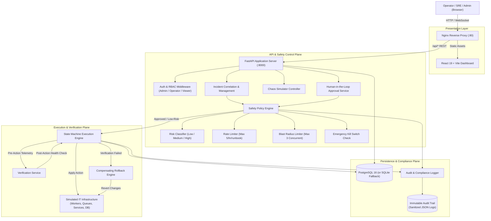
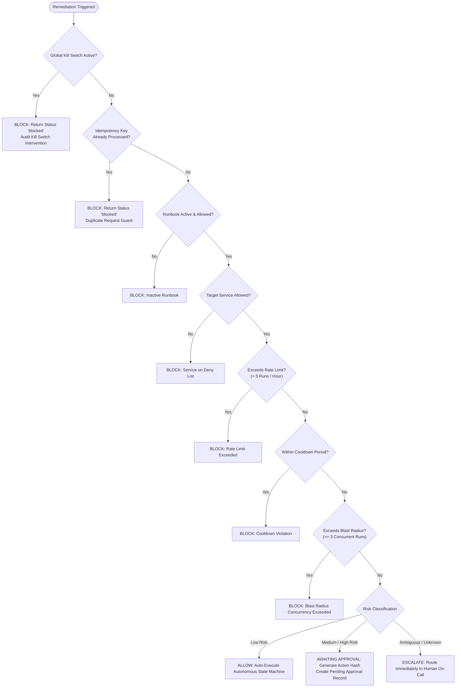
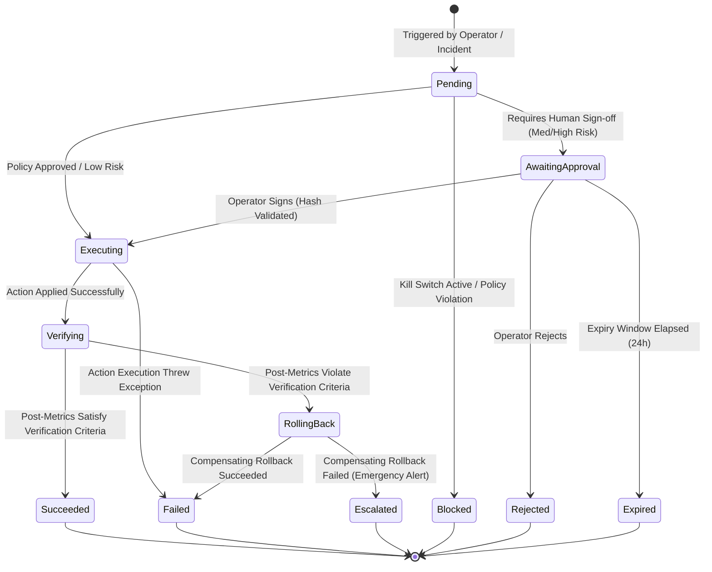
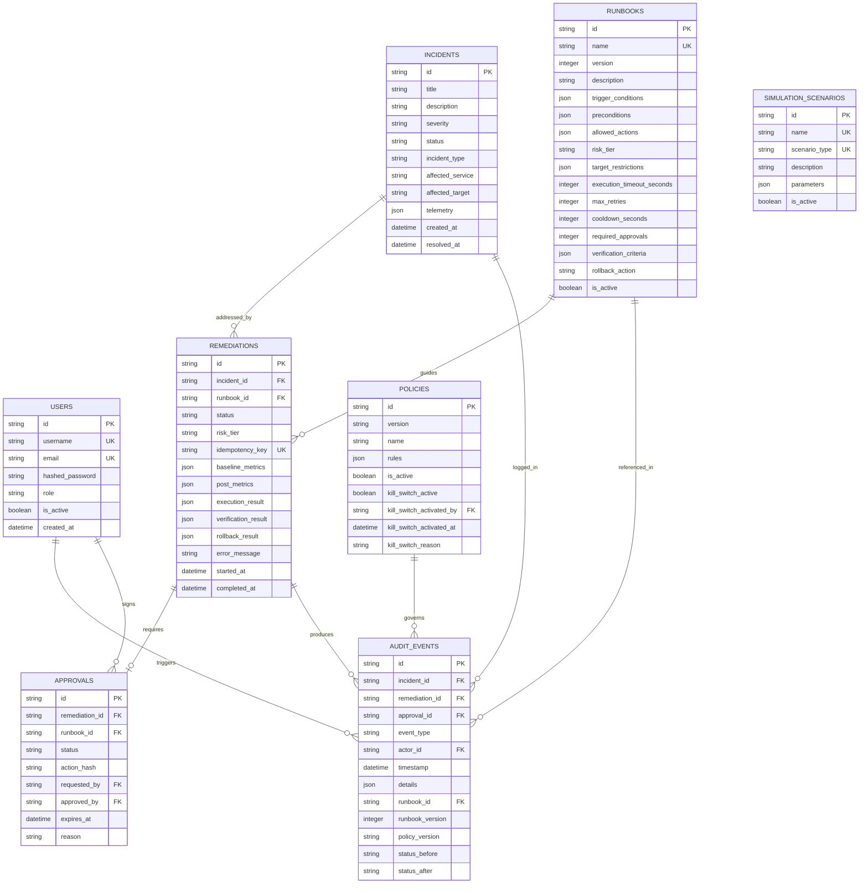

# AO-04 Architecture & Technical Design Document

This document provides a comprehensive technical specification of the **AO-04 Safe Autonomous IT Operations Remediation Platform**. It describes the core architectural layers, security invariants, state machine lifecycles, database schemas, and API design.

---

## 1. System Architecture

The AO-04 platform is structured into decoupled, safety-governed architectural planes: the **Ingress & Presentation Plane**, the **Control & Safety Plane**, the **Execution & Verification Plane**, and the **Persistence & Compliance Plane**.

---

## 2. Core Architectural Components

### 2.1 Ingress & Presentation Layer
- **Nginx Reverse Proxy (Containerized):** Listens on port `80`, serves compiled React static assets, and reverse proxies `/api/*` and `/health` requests to the FastAPI backend. Injects standard security headers (`X-Real-IP`, `X-Forwarded-For`, `X-Forwarded-Proto`).
- **React 19 / Vite Frontend:** Reactive single-page operations dashboard with Lucide React iconography, animated particle telemetry background, dark-mode operations palette, and real-time polling of incidents, approval queues, and KPI analytics.

### 2.2 API Control Plane (FastAPI)
- **FastAPI Core (`backend/app/main.py`):** High-throughput asynchronous REST application with Pydantic v2 data validation, OpenAPI 3.0 auto-documentation, CORS middleware, and application lifespan database schema bootstrapping.
- **RBAC Security (`backend/app/core/permissions.py`):** OAuth2 Password Bearer authentication evaluating role hierarchies:
  - `admin`: Global administrative privileges, safety policy modification, kill switch control.
  - `operator`: Authorized to trigger fault simulations, submit remediations, and sign approvals.
  - `viewer`: Read-only operational oversight and audit inspection.

### 2.3 Safety Policy Engine (`backend/app/services/policy_engine.py`)
Deterministic guardrail enforcement module evaluating incoming remediation requests before any system state modification:
1. **Kill Switch Verification:** Evaluates the emergency circuit breaker. If active, execution is aborted with zero exceptions.
2. **Idempotency Check:** Rejects duplicate execution attempts matching a previously committed idempotency key.
3. **Allowlist / Active Status:** Enforces that only active, verified runbooks can be triggered.
4. **Target Service Restrictions:** Checks service-level exclusion lists (e.g., protected payment gateways or critical databases).
5. **Rate Limiting:** Enforces a ceiling of **5 executions per runbook per hour**.
6. **Execution Cooldown:** Enforces minimum quiet intervals (e.g., 60-120 seconds) between successive triggers of the same runbook.
7. **Blast Radius Limiter:** Caps total active executions across the platform at **3 concurrent remediations**.

### 2.4 Risk Classifier (`backend/app/services/risk_classifier.py`)
Classifies remediations based on target criticalness, runbook complexity, and failure blast radius:
- **Low Risk:** Non-destructive actions (e.g., clearing `/tmp` files, vacuuming cache). Eligible for automated autonomous execution without human intervention.
- **Medium Risk:** Restarting background workers, scaling queue consumers, clearing dead-letter backlogs. Requires single operator authorization.
- **High Risk:** Service restarts, TLS certificate updates, database connection pool resets. Requires explicit operator authorization, subject to tight expiration deadlines.
- **Ambiguous / Novel:** Runbook mismatch or contradictory indicators. Immediately escalates to on-call engineers. **Never guesses.**

### 2.5 Execution State Machine (`backend/app/services/execution_engine.py`)
A strictly sequenced state machine driving each remediation lifecycle through defined states (`pending` -> `executing` -> `verifying` -> `succeeded` / `rolling_back` -> `failed` / `escalated`).

### 2.6 Verification & Compensating Rollback
- **Verification Service (`backend/app/services/verification_service.py`):** Samples target infrastructure metrics post-action and compares them against runbook-defined success criteria (e.g., `disk_pct < 85.0`, `status == "healthy"`).
- **Rollback Service (`backend/app/services/rollback_service.py`):** If verification fails, immediately executes compensating rollback logic (e.g., restoring snapshots, reverting consumer scale count) to return infrastructure to a stable baseline.

### 2.7 Chaos Fault Simulator (`backend/app/simulator/`)
An in-memory simulated enterprise IT infrastructure supporting 10 reproducible fault injection scenarios (`disk_usage_spike`, `worker_stuck`, `queue_backlog`, `cert_expiry`, `service_unhealthy`, `memory_pressure`, `scheduled_job_failure`, `db_connection_exhaustion`, `temp_file_accumulation`, `resource_limit_violation`).

### 2.8 Immutable Audit Trail (`backend/app/services/audit_service.py`)
Captures all system transitions, operator approvals, policy blocks, and telemetry snapshots. Automatically strips passwords, tokens, API keys, and authorization headers from event payloads before persistence.

---

## 3. Safety Policy Engine Flow

The following decision flow outlines how every remediation request is evaluated:

---

## 4. Execution State Machine Diagram

Every remediation transitions through a deterministic sequence of operational states:

### State Machine Transition Table

| Current State | Next State | Trigger / Condition | Compensating / Audit Action |
|---|---|---|---|
| `pending` | `blocked` | Kill switch active, rate limit breach, or concurrency cap. | Audit event `remediation_blocked`. |
| `pending` | `awaiting_approval` | Policy classifies action as medium or high risk. | Emits approval request with `action_hash`. |
| `pending` | `executing` | Policy allows low-risk autonomous remediation. | Baseline telemetry recorded in audit log. |
| `awaiting_approval` | `executing` | Operator submits valid approval matching `action_hash`. | Audit event `approval_granted`. |
| `awaiting_approval` | `rejected` | Operator rejects approval request. | Audit event `approval_rejected`. |
| `awaiting_approval` | `expired` | Approval not acted upon before expiration timestamp. | Audit event `approval_expired`. |
| `executing` | `verifying` | Remediation script completes execution. | Telemetry sampled for verification. |
| `verifying` | `succeeded` | Telemetry matches all verification criteria. | Incident resolved, KPI metrics incremented. |
| `verifying` | `rolling_back` | Verification fails to satisfy target conditions. | Audit event `remediation_rolling_back`. |
| `rolling_back` | `failed` | Compensating rollback successfully applied. | Incident marked failed, safe baseline restored. |
| `rolling_back` | `escalated` | Compensating rollback encountered error. | Emergency on-call paging initiated. |

---

## 5. Database Schema Overview

The database utilizes SQLAlchemy 2.0 ORM with PostgreSQL 16 (or SQLite fallback):

---

## 6. API Endpoint Reference Table

| Method | Endpoint | Role Required | Description | Request Payload / Query |
|---|---|---|---|---|
| `POST` | `/api/auth/login` | Public | Authenticate user & issue JWT token. | `{ "username": "...", "password": "..." }` |
| `GET` | `/health` | Public | Service health & database connectivity check. | None |
| `GET` | `/api/dashboard/summary` | `viewer` | High-level summary of incidents, KPIs & status. | None |
| `GET` | `/api/incidents` | `viewer` | Query and filter incident list. | `severity`, `status`, `search`, `limit`, `skip` |
| `GET` | `/api/incidents/{id}` | `viewer` | Get detailed incident record and telemetry. | None |
| `POST` | `/api/incidents/{id}/remediate` | `operator` | Trigger safety-evaluated remediation. | `{ "runbook_id": "...", "idempotency_key": "..." }` |
| `GET` | `/api/runbooks` | `viewer` | List all 10 registered operational runbooks. | `limit`, `skip` |
| `GET` | `/api/runbooks/{id}` | `viewer` | Inspect runbook triggers, actions, and verification. | None |
| `GET` | `/api/remediations` | `viewer` | List remediation records with status filter. | `status`, `incident_id`, `runbook_id` |
| `GET` | `/api/remediations/{id}` | `viewer` | Inspect pre/post metrics and verification results. | None |
| `GET` | `/api/remediations/{id}/timeline` | `viewer` | Chronological audit trail for specific remediation. | None |
| `GET` | `/api/approvals` | `operator` | List pending approval requests. | `status` (default: `pending`) |
| `POST` | `/api/approvals/{id}/approve` | `operator` | Approve remediation (validates action hash). | `{ "decision_notes": "..." }` |
| `POST` | `/api/approvals/{id}/reject` | `operator` | Reject remediation with mandatory reason. | `{ "decision_notes": "..." }` |
| `GET` | `/api/policies` | `viewer` | Retrieve currently active safety policy. | None |
| `GET` | `/api/policies/kill-switch` | `viewer` | Check emergency kill switch status. | None |
| `POST` | `/api/policies/kill-switch/activate` | `admin` | Global emergency halt of all autonomous actions. | `{ "reason": "Unusual cascade alert" }` |
| `POST` | `/api/policies/kill-switch/deactivate` | `admin` | Restore autonomous policy execution. | None |
| `GET` | `/api/simulations/scenarios` | `viewer` | List 10 chaos fault injection scenarios. | None |
| `POST` | `/api/simulations/trigger` | `operator` | Inject infrastructure fault and create incident. | `{ "scenario_type": "disk_usage_spike", ... }` |
| `POST` | `/api/simulations/reset` | `operator` | Reset all simulated services to healthy state. | None |
| `GET` | `/api/analytics/kpis` | `viewer` | Retrieve live calculated operational KPIs. | None |
| `GET` | `/api/audit` | `viewer` | Paginated query of immutable audit log records. | `event_type`, `incident_id`, `from_date`, etc. |

---

## 7. Key Security Design Decisions

### 7.1 Fail-Closed Architecture
All operations assume failure as the default branch. If a database query fails, if an unknown exception occurs, or if a policy rule cannot be evaluated, the platform blocks the execution, marks the remediation `blocked`, and notifies on-call teams.

### 7.2 Cryptographic Action Integrity (Anti-TOCTOU)
To prevent **Time-Of-Check to Time-Of-Use** attacks where a runbook or target service is altered between the time an approval is requested and the time it is authorized:
$$\text{action\_hash} = \text{SHA256}(\text{actions} \parallel \text{target} \parallel \text{runbook\_id})$$
Upon operator sign-off, the hash is recomputed against the live database record. If any divergence is detected, the approval is invalidated immediately.

### 7.3 Zero Ambiguity Guessing
Heuristic guessing is strictly prohibited in enterprise remediation. If an incoming incident does not match registered runbook trigger conditions, or if metrics conflict, the system halts with status `escalated`.

### 7.4 Non-Repudiation & Sensitive Payload Redaction
Audit logs record the exact authenticated `actor_id` or `system` entity for every transition. Payloads pass through recursive sanitization dictionaries that redact `password`, `token`, `secret`, `access_token`, and `authorization` keys to prevent credential leakage into log sinks.

### 7.5 Concurrency Ceilings & Isolation
Remediation executions are throttled at the database level using atomic transaction boundaries. The platform rejects invocations that would cause concurrent active executions to exceed the ceiling of **3 active remediations**, preventing resource exhaustion on the underlying infrastructure.
